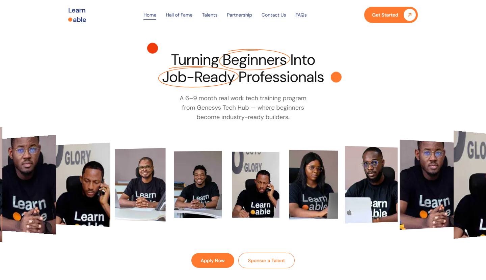

# Emmy.codes🛠️ - Full-Stack Developer Portfolio

Hi! I'm **Emmy.codes🛠️** (Emmanuel Ngene · Emmy-py 👽), a remote **Full-Stack Developer** building scalable, secure, high-performance web apps, mobile apps, websites and e-commerce platforms, from the UI down to the database.

I started as a backend engineer and now ship complete products end to end with React, Next.js, React Native, Node.js and NestJS. I'm also upskilling in **AI engineering** to integrate intelligent features into applications.

- 🌍 Based in Abuja, Nigeria  
- 💼 Open to remote freelance 
- 📫 Reach out: [LinkedIn](https://www.linkedin.com/in/emmanuel-ngene-708337263) | [X / Twitter](https://x.com/_devEmmy) | Email (add your email)

## 🛠️ Tech Stack & Skills

| Category              | Technologies & Tools                          |
|-----------------------|-----------------------------------------------|
| Frontend & Mobile     | React, Next.js, React Native, TypeScript, Tailwind CSS |
| Languages             | JavaScript, TypeScript, Python                |
| Backend               | Node.js, NestJS, Express, Python (FastAPI)    |
| Databases             | PostgreSQL, MongoDB (schema design, optimization, ORM/ODM) |
| Architecture          | RESTful APIs, Scalable microservices, Authentication (JWT, OAuth), Real-time features |
| Other                 | Git, Docker basics, CI/CD awareness, Testing (Jest) |
| Upskilling            | AI Engineering (LLM integration, vector DBs, prompt engineering) |

Focused on **clean code**, **performance**, **security**, and delivering business value.

## 🚀 Featured Projects

Here are some key projects showcasing my work:

1. **GreenVerify – Identity & Business Compliance Platform** (In Progress)  
   One-stop platform for identity verification and business compliance in Nigeria: NIN/BVN/phone verification, NIN slips and modifications, CAC business and company registration, post-incorporation filings, EFCC SCUML registration, trademark & IP registration, Tax ID / TaxPro Max, bills & airtime, and a developer verification API.  
   - **Tech**: React, Material UI, Node.js, NestJS, PostgreSQL, exploring AI for verification accuracy  
   - **Role**: Full-stack (frontend and backend)  
   - **Live (early)**: [greenverify.com.ng](https://greenverify.com.ng)

2. **Exclusive – E-Commerce Storefront**  
   A multi-category online store for electronics, fashion, home, beauty and more: a demo storefront for prospective clients, with a sliding hero, flash sales countdown, product pages and a full shopping flow. 13 responsive screens, a shop page with category filters, live search and sorting, and a cart and wishlist that persist across visits, with coupon codes.  
   - **Tech**: Next.js, React, TypeScript, Tailwind CSS, Motion  
   - **Role**: Frontend  
   - **Live**: [exclusive.emmycodes.site](https://exclusive.emmycodes.site/)

3. **Hennessy Concept – Scroll-Driven Luxury Brand Site**  
   An unofficial concept site for Hennessy cognac (not affiliated with Hennessy or Moët Hennessy): a scroll-driven WebGL pour with custom liquid, ice and condensation shaders, an automatic fallback to pre-rendered frames on slower devices, shared-element bottle transitions, flavour wheels and a fact-checked brand history. ~2 s LCP on throttled mobile, zero layout shift, zero axe violations.  
   - **Tech**: Next.js, React, TypeScript, Three.js, React Three Fiber, GSAP, Tailwind CSS  
   - **Role**: Design and development, end to end  
   - **Live**: [hennessy.emmycodes.site](https://hennessy.emmycodes.site/)

4. **AdeEmeka Wedding Invitation – Animated Digital Invitation** (Client Project)  
   Built for Amar Surprises & Event Decoration, an Enugu event planner, for her client's wedding. Guests open a sealed envelope with a wax-seal monogram and their own name on it; the flap swings open in 3D, the card slides out in a burst of petals and the music starts. Inside: the couple's photos, a live countdown, both events with directions, add-to-calendar and an RSVP form.  
   - **Tech**: Next.js, React, TypeScript, Tailwind CSS, GSAP, Canvas  
   - **Role**: Design and development  
   - **Live**: [wedding.emmycodes.site](https://wedding.emmycodes.site/)

5. **Edge Logistics – Shipping & Freight Website**  
   Website for a logistics company I imagined and own on paper, offering express delivery, freight shipping, customs clearance and warehousing. Built from a Figma design with Home, About, Contact, Get a Quote and Track Shipment pages, validated forms with success popups, a shipment tracking demo, and scroll-driven animations, responsive across phone, iPad and desktop.  
   - **Tech**: Next.js, React, TypeScript, Tailwind CSS  
   - **Role**: Design-to-code, frontend  
   - **Live**: [logistics.emmycodes.site](https://logistics.emmycodes.site/)

6. **LetDap – Social Event Management Platform**  
   Backend for a startup's innovative event app: users "dap" (connect socially), discover events, organizers manage schedules/promotions with real-time features.  
   - **Tech**: Node.js, NestJS, MongoDB  
   - **Contributions**: User matching, event CRUD, analytics APIs  
   - **Live**: [letdap.com](https://letdap.com)

7. **Learnable – Website UI Redesign**  
   A UI redesign of the website for Learnable, Genesys Tech Hub's 6–9 month project-based tech training programme. Features a draggable curved portrait hero, swipeable programme and project carousels, an FAQ accordion, a mobile menu, a custom 404 page, and scroll animations, responsive from phone to desktop.  
   - **Tech**: Next.js, React, TypeScript, Tailwind CSS  
   - **Role**: UI redesign, frontend  
   - **Live**: [learnable.emmycodes.site](https://learnable.emmycodes.site/)  
   - **Repo**: [github.com/Emmy-py/learnable-landing-page](https://github.com/Emmy-py/learnable-landing-page)

   

8. **ForeverBuy – E-Commerce Platform**  
   Fashion and lifestyle storefront for discovering trends, best sellers and exclusive collections, built for fast browsing and a smooth checkout. Product listing and detail pages, search, cart, wishlist and auth flows, with a Node.js/Express/MongoDB backend in progress for orders and payments.  
   - **Tech**: React, React Router DOM, Tailwind CSS, Vite, Node.js, MongoDB  
   - **Role**: Frontend (backend in progress)  
   - **Live**: [foreverbuy.emmycodes.site](https://foreverbuy.emmycodes.site/)

9. **CryptoTracker – Real-Time Market Analytics Platform**  
   Live cryptocurrency price tracking with WebSocket-powered updates, historical candlestick charts and market insights in a clean, performance-focused interface.  
   - **Tech**: JavaScript, WebSocket, REST APIs, market data APIs, charting libraries  
   - **Role**: Data integration and real-time update architecture  
   - **Live**: [crypto-traccker.netlify.app](https://crypto-traccker.netlify.app/)

10. **Byway Learning Management System (Backend)**  
   Robust server for an edtech platform handling user auth, course management, progress tracking, and content delivery at scale.  
   - **Tech**: Node.js, NestJS, PostgreSQL/MongoDB  
   - **Role**: Core backend developer (team: DevSquad042)  
   - **Live Frontend**: [byway1.netlify.app](https://byway1.netlify.app)  
   - **Repo**: [github.com/DevSquad042/lmsBackend](https://github.com/DevSquad042/lmsBackend)

More projects and experiments → [Full GitHub Profile](https://github.com/Emmy-py?tab=repositories)

## 🌐 Live Portfolio

Check out my interactive portfolio website:  
**[Visit Emmy.codes🛠️](https://emmycodes.site/)**  
Built with React, Vite and Tailwind CSS: a clean, responsive design showcasing my skills, services, projects, and contact details.

## 📈 GitHub Stats

  

## 🤝 Let's Build Something Great

Looking for a full-stack developer to build a web app, mobile app, website or online store, or to scale your APIs and integrate AI features?  
I'm available for remote freelance projects.

Drop me a message — let's chat! 🚀

---

⭐ Star this repo if you like the portfolio!  
Made with ❤️ by Emmy.codes🛠️
